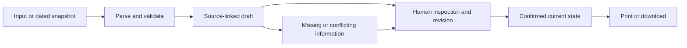

# Architecture

## Current application — October 21

Block Ops is one web app with Community, Missions/mission detail, and Map/local campaigns. The main workflow is **join → discuss → create a mission → join/claim work → post progress**. R1–R4 built map/local campaigns; B1–B2 added shared state with local Supabase. B3 repairs and its phone-layout follow-up are implemented, but the latest database migration and hosted/real-phone acceptance remain unverified. [Current scope](specs/community-missions.md), [review](B3-FOLLOWUP-REVIEW.md), [phase ledger](PHASE-STATUS.md).

### Components and ownership

| Component | Responsibility |
|---|---|
| `server.mjs` | Native Node HTTP server; explicit same-origin asset routes; browser-safe Supabase configuration; fixed read-only DC source proxies; CSP; configurable host/port and `/healthz`. No build step. |
| `public/shell.mjs` | Hash routing, shared app state, guest/session access, loading, live refresh/reconnect, status announcements, focus and persisted drafts. |
| `public/community.mjs`, `public/posts.mjs` | Community joining/feed, posts/replies, own-post edits, moderator controls and source-post navigation. Untrusted text renders as text. |
| `public/mission.mjs` | Mission list/detail/creation, reviewed campaign publication, joining, jobs, discussion, source inspection, sharing/QR and current-state export. Jobs precede sharing tools. |
| `public/community-api.mjs` | Vendored Supabase SDK access; authenticated RPC calls; typed row normalization; shared reads and subscriptions. |
| `lib/community.mjs`, `lib/mission.mjs`, `lib/drafts.mjs` | Pure validation, routes, permissions for displayed task actions, safe imported-evidence normalization, export construction and conditional draft clearing. |
| `public/app.mjs`, `public/map.mjs`, `public/storage.mjs` | Existing map/source-review/local-campaign experience, vendored Leaflet and guarded browser storage. |
| `lib/block-ops.mjs`, `lib/campaign.mjs`, `lib/recurrence.mjs` | Source-preserving normalization, reviewed local campaigns/briefs and report-filing-date proximity calculations. |
| `supabase/migrations/`, `supabase/seed.sql` | Shared relational schema, row-level permissions, RPC write functions, publication rules and labeled demonstration-community seed. |

### Shared data and trust boundaries

The shared tables are `communities`, `community_members`, `posts`, `missions`, `mission_members` and `mission_tasks`. Anonymous Auth creates a real guest session; a display name does not prove identity or residency. Community membership scopes reads; task and organizer writes are authorized in database functions using the authenticated user, not client-supplied names. Tables are SELECT-only to clients; application writes use authenticated RPCs. Removed-post originals live in a private table.

Task claims serialize membership checks and task-row updates so only one participant wins. Leaving releases unfinished claims while preserving attribution on finished jobs. The B3 migration adds membership-aware reopening: a departed participant cannot change the completed task, and an organizer reopening it returns it to the unclaimed pool. That replacement function is written but has not been exercised against a running database in the latest reviews.

Membership changes bump parent activity fields instead of publishing membership DELETE payloads. The client re-fetches permitted state on changes, reconnect and bounded polling. Realtime/polling updates do not turn localStorage into a shared database.

### Local work versus shared missions

Local campaigns remain in guarded browser storage. Publishing creates a deliberately reviewed copy: selected evidence and opted-in observations are preserved with dates/source labels; typed local owners and completion flags become unclaimed shared jobs. The local original is untouched. A mission created from discussion can have no official records and exports that absence explicitly. Shared progress, official ticket status and dated observations remain distinct facts.

### Runtime and verification

The browser receives only the Supabase URL and publishable key. Secret/service-role keys are not served and are reserved for isolated integration-test setup. Recorded city data, live queries and fictional demo cases have different visible labels. The source statistic uses filing dates, not closure dates, and cannot prove a failed cleanup or recurring incident.

Node 20+ serves the app; Node 22+ is needed for the existing browser/Realtime test tooling. Local Supabase uses the CLI and Docker, but assistants must not start Docker or apply local migrations without the explicit instruction required by [AGENTS](../AGENTS.md). No hosted provider resources have been provisioned. [Setup](COMMUNITY-SETUP.md) and [deployment runbook](DEPLOYMENT.md) contain commands, migration checks, known limits and real-phone acceptance.

Fresh independent follow-up evidence: 132 default-suite passes, 31 backend skips, and 34/34 interface checks with a fake backend. Real database permissions/concurrency, public hosting and physical phones remain outstanding. No AI, crime/Flock integration, direct messaging or photo upload is implemented or required for this slice.

## Historical baseline and earlier proposals

The sections below preserve the original baseline design and finalist comparisons. Their in-memory/no-geometry descriptions are historical; the current architecture above and community specification govern new work.

## Built baseline

**Status:** Block Ops is selected. Phase 1 chose a dependency-free Node.js 20+ server and native browser modules. The app runs locally on 127.0.0.1; no deployment is planned in this batch.

## Active Block Ops design

Bounded DC records → validated source-preserving records → same-street candidate suggestions → human include/exclude review → attributed observation and chosen ask/tasks → current-state Markdown/print brief with source appendix.

Query the DC 311 `FeatureServer/21` layer for Ward 8 and a service description containing “Dump,” over the trailing 90 days. Use the layer's America/New_York calendar, at most 1,000 records, and a fixed field allowlist: request/object IDs, category, dates, official status, ward, organization, and street address. Do not request geometry, details, or inspector names. Reject a response marked `exceededTransferLimit`; do not silently use a partial snapshot. Preserve the response fields and record the request window and retrieval time.

The grouping rule strips a leading street number and normalizes the remaining address text, then groups by street name and category. It is only a way to propose records for review. Exact address, dates, and official status remain visible in the source inspector; no group is described as a repeated incident. Use a bundled fictional sample when offline, with a persistent “Fictional demo data” label. It is not a saved DC response. Draft state remains in browser memory; failed refreshes leave the current draft intact.

The current UI separates source review, the action plan, and the finished brief. Full addresses also appear in collapsed history rows and exports. `sourceRecordUrl(record, mode)` supplies direct official links only for live records, falling back to the escaped request ID when a usable object ID is absent. Normalization rejects duplicate identity keys. A successful source/group change clears its observation/date, while loading locks editing; failed refresh preserves the current draft. See `DESIGN.md` for the interface contract.

Exact modules, contracts, commands, and phase checks are in [IMPLEMENTATION-PLAN.md](IMPLEMENTATION-PLAN.md). The table of other candidates below is historical comparison, not additional scope.

## Common shape

Use a small web interface with a source viewer, explicit draft/review state, deterministic checks, and a readable output. Keep the source and human-confirmed facts separate. Add a server only if the selected dependency needs one, such as keeping model credentials private or proxying a public API with incompatible browser access.

An optional model can propose structured fields. It cannot approve its own claims. Verify its quoted spans against source text and check deterministic constraints before asking for human confirmation.

## Candidate-specific components

| Project | Input / processing | Core state | Output |
|---|---|---|---|
| Block Ops | Bounded DC service query or dated snapshot; transparent candidate grouping | Selected request IDs, original statuses/dates, attributed observation, ask, two tasks | Group brief and source appendix |
| The Switch | Reviewed paired statements; fixed model/config; identical-input controls | Locked shared facts, exact outputs, claim/source checks, applicant approval | Confirmed summary and experiment receipt |
| Casebreaker | Two text PDFs; source-linked field suggestions; conservative comparison | Identifiers, court, dates, statuses, unresolved matches, reviewed discrepancy | Factual comparison and draft request |
| The Room | Small deterministic communication scenario | Patient goal, original words, chosen words, supporter agreement | Visit card |
| Reclaim | Historical text PDFs/manual entry; same-report source checks | Reported values/units/date/specimen, human confirmation, missing records | Evidence index and transplant-team questions |
| People's Chamber | One dated hearing notice; structured personal experience; fixed practice prompts | Sourced logistics, resident words, revised ask, rehearsal state | Testimony draft and handoff |

## Storage and network

Exploration state is in memory. Saved campaigns use browser localStorage (key `blockops.campaigns.v1`, one operator, no sync; see the revision spec section 8 for the write and failure rules). The synthetic stage fixture is the labeled practice case. No database, account, or provider key is needed.

Bound the public-data query and check transfer-limit indicators. Record query and retrieval dates. Never silently turn a saved response into a live-data claim.

Keep provider keys server-side. Validate file sizes and supported text formats before parsing. Treat source text as untrusted content. Use text-safe rendering for user content; do not interpolate untrusted values into raw HTML.

## Export contract

Generate the output from current reviewed state, rather than stale display text. Include source references, snapshot/run date when relevant, explicit unknowns, and the user's requested next step. Ensure removing evidence removes it from the export. Use browser print first if it produces a clean artifact; add a PDF library only for a demonstrated limitation.

## Deliberate cuts

No general agent orchestration layer, vector database, accounts, multiplayer, hospital/court/employer integration, public incident feed, automated outreach, or official submission pipeline in the baseline. These cuts are scope decisions, not claims about what a mature product would eventually need.
