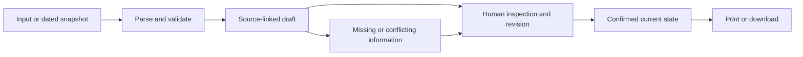

# Proposed architecture

## Revision proposal versus running architecture

Continue with [HANDOFF.md](HANDOFF.md), R1. The running architecture below is the baseline: one fixed 311 query, no geometry, GET-only server, in-memory draft. It does not implement maps, crime, saved campaigns, photos, or AI.

The proposed extension adds a real geographic selection/map, separately normalized source layers, and a durable local campaign containing reviewed evidence, observations, objective, request, task owners/dates, and follow-up history. Preserve per-source IDs, dates, links, approximate location precision, and review freshness. Do not silently force MPD records into 311 link/schema logic. Persistence and map/provider choices are builder decisions to prove in R1; no database or model was selected by this handoff.

New map assets/endpoints require explicit route and narrowly scoped CSP changes. The current 311 query must be extended to request valid geometry. MPD is a separately demonstrated public source, with block-level anonymization and reporting lag. Flock is not an available public camera source. No new routes, packages, or storage exist yet.

## Built baseline

**Status:** Block Ops is selected. Phase 1 chose a dependency-free Node.js 20+ server and native browser modules. The app runs locally on 127.0.0.1; no deployment is planned in this batch.

## Active Block Ops design

Bounded DC records → validated source-preserving records → same-street candidate suggestions → human include/exclude review → attributed observation and chosen ask/tasks → current-state Markdown/print brief with source appendix.

Query the DC 311 `FeatureServer/21` layer for Ward 8 and a service description containing “Dump,” over the trailing 90 days. Use the layer's America/New_York calendar, at most 1,000 records, and a fixed field allowlist: request/object IDs, category, dates, official status, ward, organization, and street address. Do not request geometry, details, or inspector names. Reject a response marked `exceededTransferLimit`; do not silently use a partial snapshot. Preserve the response fields and record the request window and retrieval time.

The grouping rule strips a leading street number and normalizes the remaining address text, then groups by street name and category. It is only a way to propose records for review. Exact address, dates, and official status remain visible in the source inspector; no group is described as a repeated incident. Use a bundled fictional sample when offline, with a persistent “Fictional demo data” label. It is not a saved DC response. Draft state remains in browser memory; failed refreshes leave the current draft intact.

The current UI separates source review, the action plan, and the finished brief. Full addresses also appear in collapsed history rows and exports. `sourceRecordUrl(record, mode)` supplies direct official links only for live records, falling back to the escaped request ID when a usable object ID is absent. Normalization rejects duplicate identity keys. A successful source/group change clears its observation/date, while loading locks editing; failed refresh preserves the current draft. See `DESIGN.md` for the interface contract.

Exact modules, contracts, commands, and phase checks are in [IMPLEMENTATION-PLAN.md](IMPLEMENTATION-PLAN.md). The table of other candidates below is historical comparison, not additional scope.

## Common shape

Use a small web interface with a source viewer, explicit draft/review state, deterministic checks, and a readable output. Keep the source and human-confirmed facts separate. Add a server only if the selected dependency needs one, such as keeping model credentials private or proxying a public API with incompatible browser access.

An optional model can propose structured fields. It cannot approve its own claims. Verify its quoted spans against source text and check deterministic constraints before asking for human confirmation.

## Candidate-specific components

| Project | Input / processing | Core state | Output |
|---|---|---|---|
| Block Ops | Bounded DC service query or dated snapshot; transparent candidate grouping | Selected request IDs, original statuses/dates, attributed observation, ask, two tasks | Group brief and source appendix |
| The Switch | Reviewed paired statements; fixed model/config; identical-input controls | Locked shared facts, exact outputs, claim/source checks, applicant approval | Confirmed summary and experiment receipt |
| Casebreaker | Two text PDFs; source-linked field suggestions; conservative comparison | Identifiers, court, dates, statuses, unresolved matches, reviewed discrepancy | Factual comparison and draft request |
| The Room | Small deterministic communication scenario | Patient goal, original words, chosen words, supporter agreement | Visit card |
| Reclaim | Historical text PDFs/manual entry; same-report source checks | Reported values/units/date/specimen, human confirmation, missing records | Evidence index and transplant-team questions |
| People's Chamber | One dated hearing notice; structured personal experience; fixed practice prompts | Sourced logistics, resident words, revised ask, rehearsal state | Testimony draft and handoff |

## Storage and network

Default to local in-memory draft state and the synthetic stage fixture. No database, account, local-storage persistence, or provider key is needed for this single-user workflow.

Bound the public-data query and check transfer-limit indicators. Record query and retrieval dates. Never silently turn a saved response into a live-data claim.

Keep provider keys server-side. Validate file sizes and supported text formats before parsing. Treat source text as untrusted content. Use text-safe rendering for user content; do not interpolate untrusted values into raw HTML.

## Export contract

Generate the output from current reviewed state, rather than stale display text. Include source references, snapshot/run date when relevant, explicit unknowns, and the user's requested next step. Ensure removing evidence removes it from the export. Use browser print first if it produces a clean artifact; add a PDF library only for a demonstrated limitation.

## Deliberate cuts

No general agent orchestration layer, vector database, accounts, multiplayer, hospital/court/employer integration, public incident feed, automated outreach, or official submission pipeline in the baseline. These cuts are scope decisions, not claims about what a mature product would eventually need.
