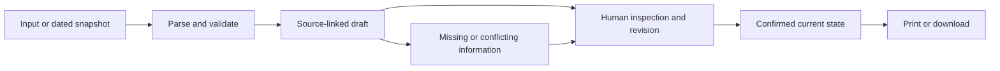

# Proposed architecture

**Status:** design guidance until a project is chosen. There is no application stack or deployment yet. Do not build a six-product platform.

## Common shape

Use a small web interface with a source viewer, explicit draft/review state, deterministic checks, and a readable output. Keep the source and human-confirmed facts separate. Add a server only if the selected dependency needs one, such as keeping model credentials private or proxying a public API with incompatible browser access.

An optional model can propose structured fields. It cannot approve its own claims. Verify its quoted spans against source text and check deterministic constraints before asking for human confirmation.

## Candidate-specific components

| Project | Input / processing | Core state | Output |
|---|---|---|---|
| Block Ops | Bounded DC service query or dated snapshot; transparent candidate grouping | Selected request IDs, original statuses/dates, attributed observation, ask, two tasks | Group brief and source appendix |
| The Switch | Reviewed paired statements; fixed model/config; identical-input controls | Locked shared facts, exact outputs, claim/source checks, applicant approval | Confirmed summary and experiment receipt |
| Casebreaker | Two text PDFs; source-linked field suggestions; conservative comparison | Identifiers, court, dates, statuses, unresolved matches, reviewed discrepancy | Factual comparison and draft request |
| The Room | Small deterministic communication scenario | Patient goal, original words, chosen words, supporter agreement | Visit card |
| Reclaim | Historical text PDFs/manual entry; same-report source checks | Reported values/units/date/specimen, human confirmation, missing records | Evidence index and transplant-team questions |
| People's Chamber | One dated hearing notice; structured personal experience; fixed practice prompts | Sourced logistics, resident words, revised ask, rehearsal state | Testimony draft and handoff |

## Storage and network

Default to local draft state and synthetic stage fixtures. Do not add a database for a single-user hackathon workflow without a demonstrated need. If persistence is selected, define retention and deletion and avoid storing sensitive records by default.

Bound any public-data query and handle pagination or transfer-limit indicators. Record query and snapshot dates. Cache labels must remain visible. Never silently turn a saved response into a live-data claim.

Keep provider keys server-side. Validate file sizes and supported text formats before parsing. Treat source text as untrusted content. Use text-safe rendering for user content; do not interpolate untrusted values into raw HTML.

## Export contract

Generate the output from current reviewed state, rather than stale display text. Include source references, snapshot/run date when relevant, explicit unknowns, and the user's requested next step. Ensure removing evidence removes it from the export. Use browser print first if it produces a clean artifact; add a PDF library only for a demonstrated limitation.

## Deliberate cuts

No general agent orchestration layer, vector database, accounts, multiplayer, hospital/court/employer integration, public incident feed, automated outreach, or official submission pipeline in the baseline. These cuts are scope decisions, not claims about what a mature product would eventually need.
