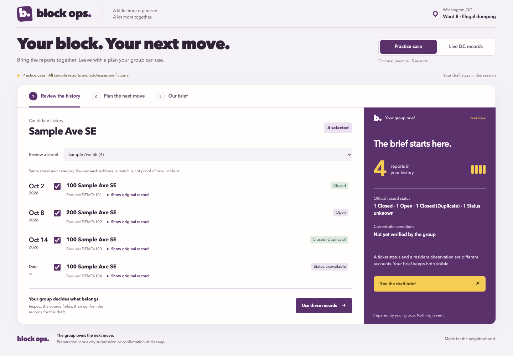
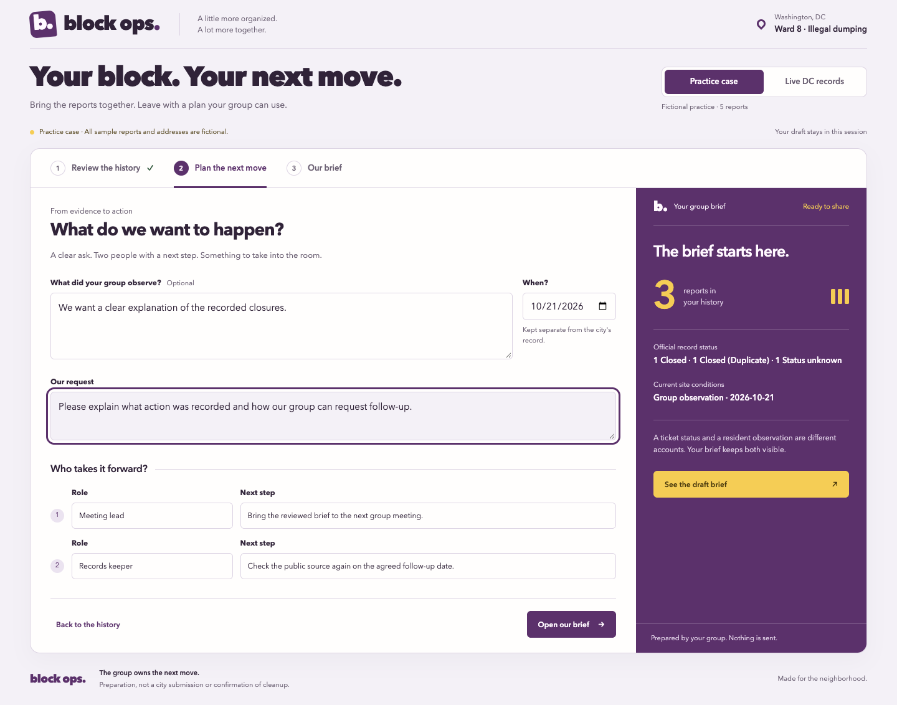
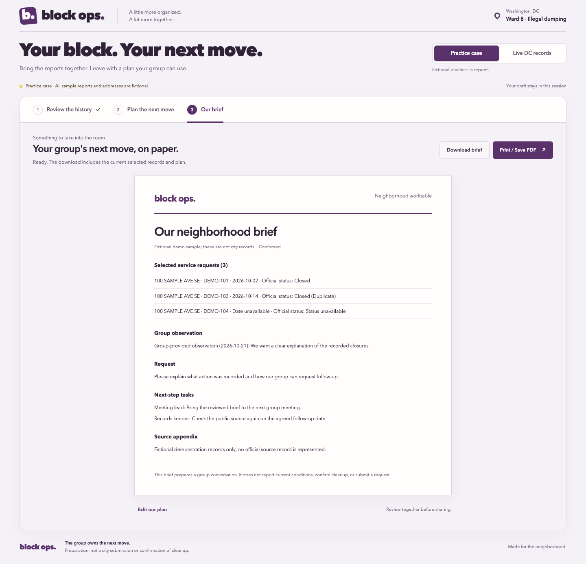

# Block Ops — MVP UI investigation and repair

October 21, 2026. The user requested investigation after Luna completed phases 1–3 and rejected the initial interface as unsuitable for presenting.

## Finding

The functional baseline passed 17/17 tests. The implementation displayed records, every planning field, and the final artifact simultaneously on a long page. Its repeated headings and equal-weight panels obscured the main decision and the resulting artifact. The collapsed list hid house numbers, making it harder to distinguish candidate locations. The phase plan had deferred visual work to Phase 5; functional completion was not evidence of presentation quality.

## Current interface

The existing plum/sunflower identity now supports three task views:

1. **Review the history:** see actual dates, full addresses, original source disclosures, include/exclude controls, and a summary reflecting the current evidence.
2. **Plan the next move:** add the group's own observation and date, edit its request, and assign two role-based tasks.
3. **Our brief:** inspect the current source-linked paper, download Markdown, or print/save a PDF.

The practice fixture is explicitly fictional. Three candidate reports use the same invented address; `DEMO-102` has another address on that street, giving the judge a concrete exclusion to inspect. These sample changes do not modify any real public record or prove any real relationship.

## Functional repairs

- Null/blank object IDs no longer generate `OBJECTID=0` links; live sources fall back to a quoted/escaped request ID.
- Successful source/group changes clear the old context's observation/date. Failed refreshes preserve the current reviewed draft.
- Loading makes the workspace inert so a pending request cannot overwrite an intervening selection edit.
- Duplicate normalized identities are rejected rather than letting one selected key export multiple rows.
- Briefs now retain selected addresses and direct live source links; excluded records' details stay excluded. Fictional fixtures receive no official source links.

## Verification

`node --test` passed 23/23. Browser checks in Chromium exercised the working flow, changed output, an inspected Markdown download, real loading of 389 DC records, a simulated failed refresh, source/group changes, missing observation date, and keyboard tabs. All three views were checked at 1440, 1024, 768, 390, and 320 pixels with no observed browser errors or measured horizontal overflow.

The fictional sample's A4 output was rendered and visually inspected. Independent visual review confirmed the improved task hierarchy and found two mobile issues—wordmark wrapping and overlong candidate options—which were fixed and re-inspected. The mechanical design scan returned no findings. These checks do not establish full accessibility conformance, community usefulness, or projection-distance legibility.

[Browser results](blockops-ui-results.json). See [TEST-PLAN.md](../TEST-PLAN.md) for commands and limitations. Phases 4–5 remain in progress for the remaining acceptance and final stage checks.

## Screenshots

These are the actual local application using fictional data, not concept renders.

[390-pixel history](blockops-review-390.png) · [320-pixel plan](blockops-plan-320.png).
